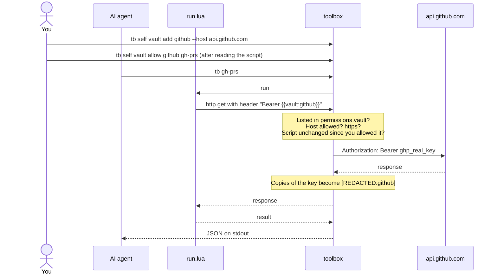

<h1 align="center">
  <picture>
    <source media="(prefers-color-scheme: dark)" srcset="assets/toolbox-wordmark-dark.svg">
    
  </picture>
</h1>

<h3 align="center">Give your AI new tools, not your API keys.</h3>

<p align="center">
  A CLI your AI can keep extending. Commands are small Lua scripts.<br>
  API keys stay in the keychain, out of the AI's reach.
</p>

<p align="center">
  <a href="LICENSE"></a>
  
  
  
</p>

<p align="center">
  <a href="#install"><b>Install</b></a> &nbsp;·&nbsp;
  <a href="#quick-start"><b>Quick start</b></a> &nbsp;·&nbsp;
  <a href="#why-toolbox"><b>Why</b></a> &nbsp;·&nbsp;
  <a href="docs/README.md"><b>Docs</b></a> &nbsp;·&nbsp;
  <a href="https://github.com/WilliamThogersen/toolbox-commands"><b>Marketplace</b></a>
</p>

<p align="center">
  
</p>

## Why toolbox?

Every command is a folder with a `command.json` (name, args, permissions) and a `run.lua` (the logic).
Drop a folder in `~/.toolbox/commands/` and it is a new subcommand. No rebuild.

<table>
  <tr>
    <td width="33%" valign="top"> <b>New command, new folder</b><br>An AI can add a tool in seconds and use it right away.</td>
    <td width="33%" valign="top"> <b>JSON out, always</b><br>Results on stdout as JSON. Errors are <code>{"error": "..."}</code> on stderr, exit 1.</td>
    <td width="33%" valign="top"> <b>Nothing it didn't ask for</b><br>Each command lists the hosts, programs, env vars, folders and keys it may touch.</td>
  </tr>
  <tr>
    <td valign="top"> <b>Keys the AI can use but never see</b><br>Scripts get a placeholder; the real key is swapped in only for commands you approved.</td>
    <td valign="top"> <b>A tool in any AI app</b><br><code>tb self mcp</code> serves every command as an MCP tool.</td>
    <td valign="top"> <b>Share through git</b><br>Install from any GitHub or GitLab repo, or save whole marketplaces and search them.</td>
  </tr>
</table>

|  | Without toolbox | With toolbox |
|---|---|---|
| Where the key lives | Pasted into the prompt or an env var | In the vault (macOS keychain) |
| What the agent sees | The real key, `ghp_...` | Only `{{vault:github}}` |
| Where the key can go | Anywhere the agent sends it | Only to hosts you approved, from commands you allowed |
| Key echoed back in a response | Visible to the agent | Redacted as `[REDACTED:github]` |

**Works with:** Claude Code · Cursor · any MCP client — via [`tb self mcp`](docs/commands/mcp.md).

## Install

```bash
brew install WilliamThogersen/tap/toolbox
```

Installs `toolbox` and `tb` (same program; `tb` is a symlink) on macOS (Apple Silicon and Intel) and Linux (x86_64 and arm64).
Update with `brew upgrade toolbox`. The key vault is **macOS only for now**: on Linux the system keyring gives keys to any
program, so toolbox doesn't use it ([why](docs/security.md#what-it-does-not-protect-against)).

<sub>When a new version is out, `tb` says so on your terminal (checked at most once a day, only when a person is at the
terminal; agents and pipes never see it). Set `TOOLBOX_NO_UPDATE_CHECK=1` to turn it off.</sub>

## Quick start

```console
$ tb self new hello --description "Says hello"
$ tb hello --name you
{
  "message": "hello you"
}
$ tb
Usage: tb <command> [args]

Commands:
  hello  Says hello

Manage commands and API keys: tb self
```

Or start from ready-made commands in the [starter marketplace](https://github.com/WilliamThogersen/toolbox-commands)
(`crate`, `npm`, `pypi`, `weather`, `hn`, `gh-repo`, `gh-prs`):

```console
$ tb self market add starter https://github.com/WilliamThogersen/toolbox-commands.git
$ tb self install starter/weather
```

<details>
<summary><b>A real example: <code>stars</code></b></summary>

`~/.toolbox/commands/stars/command.json`:

```json
{
  "name": "stars",
  "version": "1.0.0",
  "description": "Star count for a GitHub repo",
  "args": { "repo": { "type": "string", "required": true, "description": "owner/repo" } },
  "permissions": { "http": ["api.github.com"] }
}
```

`run.lua`:

```lua
return function(args)
  local res = http.get("https://api.github.com/repos/" .. args.repo, {
    headers = { ["User-Agent"] = "toolbox" },
  })
  if res.status ~= 200 then error("GitHub returned " .. res.status) end
  return { repo = res.json.full_name, stars = res.json.stargazers_count }
end
```

```console
$ tb stars --repo rust-lang/rust
{
  "repo": "rust-lang/rust",
  "stars": 120656
}
```

</details>

Next: [Writing commands](docs/writing-commands.md) has every `command.json` field and the full Lua API.

## How the vault works

You store a key once, at your own terminal, and say which hosts it may go to. A script asks for it by name and only
ever gets the placeholder `{{vault:github}}`. toolbox swaps in the real key while sending, and only when every check
passes. Any copy of the key in the response is redacted before the script sees it. Agents can't add, allow or read
keys: every vault change needs a person at a real terminal.

<details>
<summary><b>Show the flow</b></summary>



</details>

## Commands

Plain `tb` lists only your own commands. Everything that manages toolbox lives under `tb self`.

<details>
<summary><b>All <code>tb self</code> commands</b></summary>

| Command | What it does |
|---------|--------------|
| [`tb self new <name>`](docs/commands/new.md) | Create a command from a template |
| [`tb self check`](docs/commands/check.md) | Validate every command, exit 1 on problems |
| [`tb self describe`](docs/commands/describe.md) | Every command, its args and permissions, as JSON |
| [`tb self guide`](docs/commands/guide.md) | Print the reference for writing commands |
| [`tb self install <source>`](docs/commands/install.md) | Install commands from a git repo or a saved marketplace |
| [`tb self search [<text>]`](docs/commands/search.md) | Search the commands in every saved marketplace |
| [`tb self update [<name>]`](docs/commands/update.md) | Update installed commands to their newest version |
| [`tb self uninstall <name>`](docs/commands/uninstall.md) | Remove an installed command |
| [`tb self market`](docs/commands/market.md) | Save, list and remove marketplaces |
| [`tb self vault`](docs/commands/vault.md) | Add API keys and choose which commands may use them |
| [`tb self mcp`](docs/commands/mcp.md) | Serve your commands as MCP tools for Claude Code and other AI apps |

</details>

## Docs

-  [Writing commands](docs/writing-commands.md): `command.json`, the Lua API, the vault
-  [Sharing commands](docs/sharing.md): host your own repo or marketplace, release versions
-  [Security](docs/security.md): what commands can touch, the risks of installing, what the vault protects
-  [AI agents](docs/ai-agents.md): the snippet for your `CLAUDE.md`, output rules
-  [Development](docs/development.md): build, test, release, project layout

## Security

Commands can only touch what their `command.json` declares. Installing someone else's command still means running their
code, so read it first. The vault is macOS only for now. Details, and what toolbox does **not** protect against:
[docs/security.md](docs/security.md#the-vault).

## License

[MIT](LICENSE)

---

<p align="center">
  If toolbox is useful to you,  <b>star the repo</b>, try the
  <a href="https://github.com/WilliamThogersen/toolbox-commands">starter marketplace</a>,
  and contributions are welcome (see <a href="docs/development.md">Development</a>).
</p>

