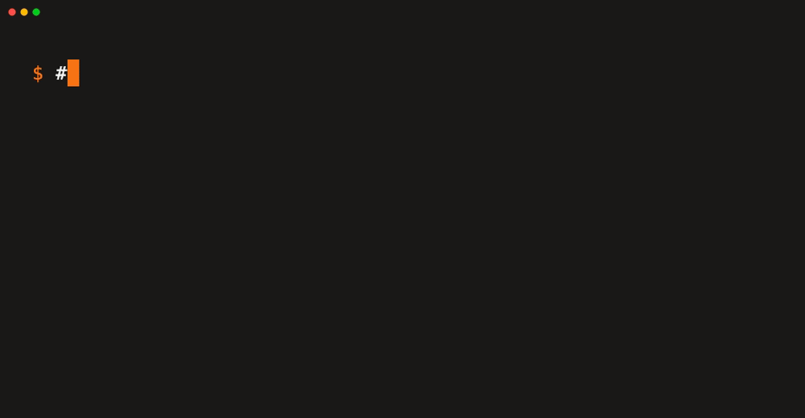
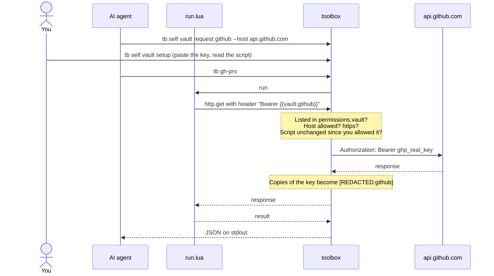

<h1 align="center">
  <picture>
    <source media="(prefers-color-scheme: dark)" srcset="assets/toolbox-wordmark-dark.svg">
    
  </picture>
</h1>

<h3 align="center">Give your AI new tools. Not your API keys.</h3>

<p align="center">
  Your AI writes a tiny Lua script, and it's a new command. No rebuild, no server, no plugin system.<br>
  It can call any API you allow, with keys it can use but never read.
</p>

<p align="center">
  <a href="LICENSE"></a>
  
  
</p>

<p align="center">
  <a href="#-install"><b>Install</b></a> &nbsp;·&nbsp;
  <a href="#-build-a-command-in-two-minutes"><b>Build a command</b></a> &nbsp;·&nbsp;
  <a href="#-use-an-api-key-without-handing-it-over"><b>Vault</b></a> &nbsp;·&nbsp;
  <a href="docs/README.md"><b>Docs</b></a> &nbsp;·&nbsp;
  <a href="https://github.com/WilliamThogersen/toolbox-commands"><b>Marketplace</b></a>
</p>

<p align="center">
  
</p>

## 🤔 The problem

You want your AI agent to check your PRs, look up a package or hit your company's API. So you paste it a key.
Now that key sits in the chat log, the agent can print it, and nothing stops it from sending it anywhere.

**toolbox** gives the agent a place to build its own tools, and a vault that keeps the keys out of its hands.

## ✨ Why toolbox

- ⚡ **Two files, one new command.** A folder with `command.json` and `run.lua` becomes `tb <name>`. No compile, no restart. Your AI writes it and uses it the same minute.
- 🔑 **Keys it can use but never see.** Scripts only get `{{vault:github}}`. The real key is swapped in on the way out, for hosts and commands you approved.
- ✋ **You approve the risky calls.** Limit a key to `GET` or to `/repos/acme`, and have macOS ask for Touch ID before each write it makes.
- 🔄 **Sign-ins too.** OAuth keys (Google, Microsoft, Slack) sign in once in your browser and renew themselves. The agent never sees a token.
- 👀 **Watch it live.** `tb self vault log --pretty --follow` shows every key use and refusal as it happens.
- 🔒 **Sandboxed by default.** A command can only touch the hosts, programs, env vars, folders and keys its `command.json` lists.
- 🧾 **JSON out, always.** Results on stdout, errors as `{"error": "..."}` on stderr. Easy for agents to read.
- 🔌 **A tool in any AI app.** `tb self mcp` serves every command as an MCP tool for Claude Code, Claude Desktop, Cursor and more.
- 📦 **Share through git.** Install from any GitHub or GitLab repo, or save whole marketplaces and search them.

|  | 😬 Without toolbox | 😌 With toolbox |
|---|---|---|
| Where the key lives | Pasted into the prompt or an env var | In the vault (macOS Keychain) |
| What the agent sees | The real key, `ghp_...` | Only `{{vault:github}}` |
| Where the key can go | Anywhere the agent sends it | Only to hosts you approved, from commands you allowed |
| What the key can do | Everything the token allows | Only the methods and paths you set, with Touch ID per write if you like |
| Key echoed back in a response | Visible to the agent | Redacted as `[REDACTED:github]` |

## 🚀 Install

```bash
brew install WilliamThogersen/tap/toolbox
```

Works on macOS (Apple Silicon and Intel) and Linux (x86_64 and arm64). You get `toolbox` and the short name `tb`.
Update with `brew upgrade toolbox`. The key vault is **macOS only for now** ([why](docs/security.md#what-it-does-not-protect-against)).

<sub>When a new version is out, `tb` says so on your terminal (at most once a day, only when a person is at the
terminal; agents and pipes never see it). Set `TOOLBOX_NO_UPDATE_CHECK=1` to turn it off.</sub>

## 🔨 Build a command in two minutes

**1. Create it.**

```console
$ tb self new stars --description "Star count for a GitHub repo"
```

This makes `~/.toolbox/commands/stars/` with two files.

**2. Say what it takes and what it may touch** in `command.json`:

```json
{
  "name": "stars",
  "description": "Star count for a GitHub repo",
  "args": { "repo": { "type": "string", "required": true, "description": "owner/repo" } },
  "permissions": { "http": ["api.github.com"] }
}
```

**3. Write the logic** in `run.lua`:

```lua
return function(args)
  local res = http.get("https://api.github.com/repos/" .. args.repo, {
    headers = { ["User-Agent"] = "toolbox" },
  })
  if res.status ~= 200 then error("GitHub returned " .. res.status) end
  return { repo = res.json.full_name, stars = res.json.stargazers_count }
end
```

**4. Run it.**

```console
$ tb stars --repo rust-lang/rust
{
  "repo": "rust-lang/rust",
  "stars": 120656
}
```

That's it. 🎉 It shows up in `tb`, in `tb self describe` and as an MCP tool.
Scripts also get `fs`, `exec`, `json`, `time`, `base64`, `hash` and more, each behind a permission.
Every field and function is in [Writing commands](docs/writing-commands.md).

## 🔑 Use an API key without handing it over

**1. Your agent asks for it by name** in the script, lists it under `"vault": ["github"]` in `command.json`, and
requests it. That needs no terminal and never touches the vault:

```lua
headers = { Authorization = "Bearer " .. vault("github") }
```

```console
$ tb self vault request github --host api.github.com --why "Read star counts of your private GitHub repos" \
    --note "Get it at https://github.com/settings/tokens"
```

**2. You paste the key and read the script, in one go:**

```console
$ tb self vault setup

Key github was requested
  why: Read star counts of your private GitHub repos
  note: Get it at https://github.com/settings/tokens
  used by stars
Hosts it may go to (Enter keeps api.github.com, - skips this key):
Paste the key for github (input is hidden, empty skips it):
stars wants to use your key github
  ...
Allow stars to use github? [y/N, v = read the whole script] y
```

Rather type it all yourself? `tb self vault add github --host api.github.com`, then `tb self vault allow github stars`.

The script only ever holds `{{vault:github}}`. toolbox swaps in the real key while sending, and any copy of it in the
response comes back as `[REDACTED:github]`. Edit the script and the approval is gone until you allow it again.
Every vault change asks for Touch ID or your password, in a macOS dialog an agent can't answer.

<details>
<summary><b>See the full flow</b></summary>



</details>

## 🤖 Hook up your AI

**Let it build tools.** One command tells Claude Code to use your commands first and write new ones:

```bash
tb self init
```

It writes `~/.claude/TOOLBOX.md` and imports it from your `CLAUDE.md`. Other agents: copy
[the instructions](docs/agent-instructions.md) into their instructions file.

**Let it call them as tools.** Any MCP app works:

```bash
claude mcp add toolbox -- tb self mcp
```

New commands show up as tools within seconds. Setup for Claude Desktop, Cursor and others: [`tb self mcp`](docs/commands/mcp.md).

## 📦 Ready-made commands

Skip the writing and grab some from the [starter marketplace](https://github.com/WilliamThogersen/toolbox-commands)
(`crate`, `npm`, `pypi`, `weather`, `hn`, `gh-repo`, `gh-prs`):

```console
$ tb self market add starter https://github.com/WilliamThogersen/toolbox-commands.git
$ tb self search weather
$ tb self install starter/weather
```

Every install shows the permissions first and waits for your yes. Want to publish your own? See [Sharing commands](docs/sharing.md).

## 📚 Docs

- ✍️ [Writing commands](docs/writing-commands.md): `command.json`, the Lua API, the vault
- 🤝 [Sharing commands](docs/sharing.md): host your own repo or marketplace, release versions
- 🛡️ [Security](docs/security.md): what commands can touch, the risks of installing, what the vault protects
- 🤖 [AI agents](docs/ai-agents.md): `tb self init`, output rules
- 🔧 [Development](docs/development.md): build, test, release, project layout

<details>
<summary><b>🧰 All <code>tb self</code> commands</b></summary>

Plain `tb` lists only your own commands. Everything that manages toolbox lives under `tb self`.

| Command | What it does |
|---------|--------------|
| [`tb self new <name>`](docs/commands/new.md) | Create a command from a template |
| [`tb self check`](docs/commands/check.md) | Validate every command, exit 1 on problems |
| [`tb self describe`](docs/commands/describe.md) | Every command, its args and permissions, as JSON |
| [`tb self guide`](docs/commands/guide.md) | Print the reference for writing commands |
| [`tb self install <source>`](docs/commands/install.md) | Install commands from a git repo or a saved marketplace |
| [`tb self search [<text>]`](docs/commands/search.md) | Search the commands in every saved marketplace |
| [`tb self update [<name>]`](docs/commands/update.md) | Update installed commands to their newest version |
| [`tb self uninstall <name>`](docs/commands/uninstall.md) | Remove an installed command |
| [`tb self market`](docs/commands/market.md) | Save, list and remove marketplaces |
| [`tb self vault`](docs/commands/vault.md) | API keys: agents request them, you paste them and choose which commands may use them |
| [`tb self mcp`](docs/commands/mcp.md) | Serve your commands as MCP tools for Claude Code and other AI apps |

</details>

## 🛡️ Security

Commands can only touch what their `command.json` declares. Installing someone else's command still means running their
code, so read it first. Details, and what toolbox does **not** protect against: [docs/security.md](docs/security.md#the-vault).

## 📄 License

[MIT](LICENSE)

---

<p align="center">
  ⭐ If toolbox kept a key out of your chat log, <b>star the repo</b>.<br>
  Contributions welcome: see <a href="docs/development.md">Development</a>.
</p>
