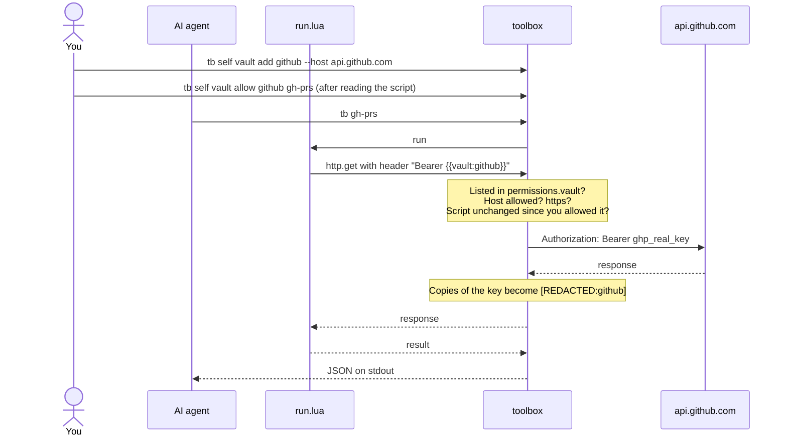

<h1 align="center">
  <picture>
    <source media="(prefers-color-scheme: dark)" srcset="assets/toolbox-wordmark-dark.svg">
    
  </picture>
</h1>

<p align="center">
  <strong>A CLI your AI can keep extending.</strong><br>
  Commands are small Lua scripts. API keys stay in the keychain, out of the AI's reach.
</p>

<p align="center">
  <a href="LICENSE"></a>
  
  
</p>

<p align="center">
  <a href="#install">Install</a> ·
  <a href="#quick-start">Quick start</a> ·
  <a href="#commands">Commands</a> ·
  <a href="docs/README.md">Docs</a>
</p>

<p align="center">
  
</p>

Every command is a folder with a `command.json` (name, args, permissions) and a `run.lua` (the logic).
Drop a folder in `~/.toolbox/commands/` and it is a new subcommand. No rebuild.

- **New command, new folder.** An AI can add a tool in seconds and use it right away.
- **JSON out, always.** Results go to stdout as JSON. Errors are `{"error": "..."}` on stderr with exit code 1.
- **Nothing it didn't ask for.** Each command lists the hosts, programs, env vars, folders and keys it may touch. Everything else fails.
- **Keys the AI can use but never see.** Scripts get a placeholder. toolbox swaps in the real key on the way out, only for commands you approved.
- **A tool in any AI app.** `tb self mcp` serves every command as an MCP tool for Claude Code, Cursor and others.
- **Share through git.** Install commands from any GitHub or GitLab repo, or save whole marketplaces and search them.

`tb` and `toolbox` are the same program: `tb` is a symlink for typing less.

## Install

```bash
brew install WilliamThogersen/tap/toolbox
```

This installs `toolbox` and `tb` (macOS, Apple Silicon and Intel). Update with `brew upgrade toolbox`.

When a new version is out, `tb` says so on your terminal. It asks GitHub at most once a day, and only when a
person is at the terminal: agents and pipes never see the notice. Set `TOOLBOX_NO_UPDATE_CHECK=1` to turn it off.

## Quick start

```console
$ tb self new hello --description "Says hello"
$ tb hello --name you
{
  "message": "hello you"
}
$ tb
Usage: tb <command> [args]

Commands:
  hello  Says hello

Manage commands and API keys: tb self
```

A real one, `~/.toolbox/commands/stars/`:

```json
{
  "name": "stars",
  "version": "1.0.0",
  "description": "Star count for a GitHub repo",
  "args": { "repo": { "type": "string", "required": true, "description": "owner/repo" } },
  "permissions": { "http": ["api.github.com"] }
}
```

```lua
return function(args)
  local res = http.get("https://api.github.com/repos/" .. args.repo, {
    headers = { ["User-Agent"] = "toolbox" },
  })
  if res.status ~= 200 then error("GitHub returned " .. res.status) end
  return { repo = res.json.full_name, stars = res.json.stargazers_count }
end
```

```console
$ tb stars --repo rust-lang/rust
{
  "repo": "rust-lang/rust",
  "stars": 120656
}
```

Next: [Writing commands](docs/writing-commands.md) has every `command.json` field and the full Lua API.

Or start from ready-made ones: the [starter marketplace](https://github.com/WilliamThogersen/toolbox-commands) has
`crate`, `npm`, `pypi`, `weather`, `hn`, `gh-repo` and `gh-prs`.

```console
$ tb self market add starter https://github.com/WilliamThogersen/toolbox-commands.git
$ tb self install starter/weather
```

## How the vault works

You store a key once, at your own terminal, and say which hosts it may go to. A script asks for it by name and only
ever gets the placeholder `{{vault:github}}`. toolbox swaps in the real key while sending, and only when every check
passes. Any copy of the key in the response is redacted before the script sees it.



Agents can't add, allow or read keys: every vault change needs a person at a real terminal. What this does and
doesn't protect against: [Security](docs/security.md#the-vault).

## Commands

Plain `tb` lists only your own commands. Everything that manages toolbox lives under `tb self`, and each has its own
page:

| Command | What it does |
|---------|--------------|
| [`tb self new <name>`](docs/commands/new.md) | Create a command from a template |
| [`tb self check`](docs/commands/check.md) | Validate every command, exit 1 on problems |
| [`tb self describe`](docs/commands/describe.md) | Every command, its args and permissions, as JSON |
| [`tb self guide`](docs/commands/guide.md) | Print the reference for writing commands |
| [`tb self install <source>`](docs/commands/install.md) | Install commands from a git repo or a saved marketplace |
| [`tb self search [<text>]`](docs/commands/search.md) | Search the commands in every saved marketplace |
| [`tb self update [<name>]`](docs/commands/update.md) | Update installed commands to their newest version |
| [`tb self uninstall <name>`](docs/commands/uninstall.md) | Remove an installed command |
| [`tb self market`](docs/commands/market.md) | Save, list and remove marketplaces |
| [`tb self vault`](docs/commands/vault.md) | Add API keys and choose which commands may use them |
| [`tb self mcp`](docs/commands/mcp.md) | Serve your commands as MCP tools for Claude Code and other AI apps |

## Docs

- [Writing commands](docs/writing-commands.md): `command.json`, the Lua API, the vault
- [Sharing commands](docs/sharing.md): host your own repo or marketplace, release versions
- [Security](docs/security.md): what commands can touch, the risks of installing, what the vault protects
- [AI agents](docs/ai-agents.md): the snippet for your `CLAUDE.md`, output rules
- [Development](docs/development.md): build, test, release, project layout

## License

[MIT](LICENSE)
